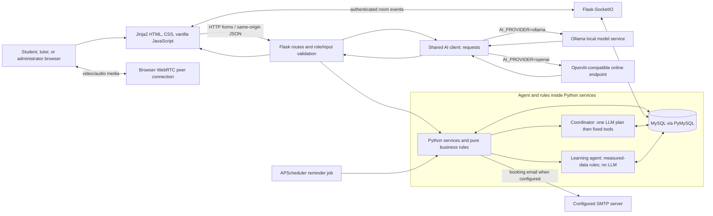
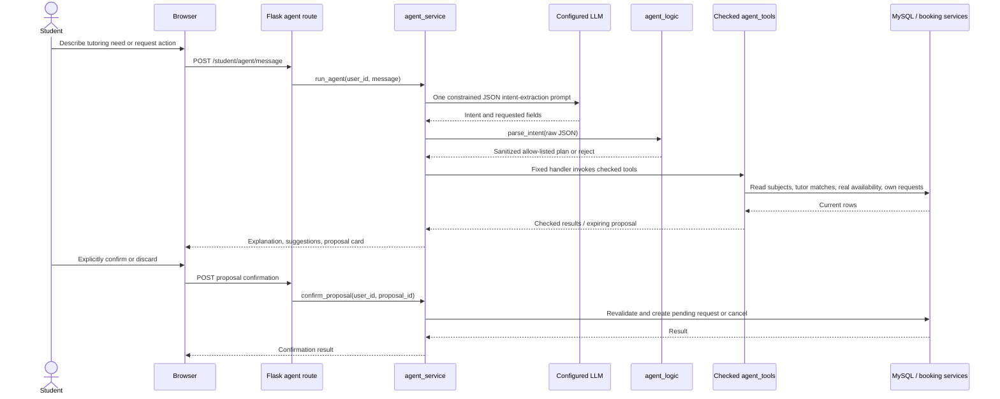
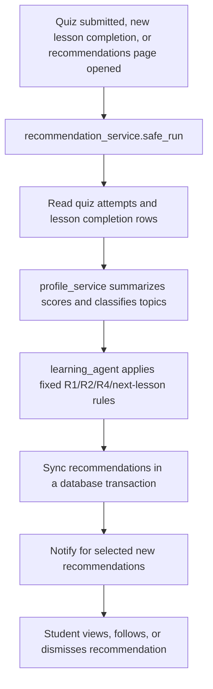

# AI AGENTS, AI ASSISTANTS, BOTS, AUTOMATION, AND SYSTEM ARCHITECTURE ANALYSIS

## Scope and evidence standard

This report describes the implementation currently present in the repository. It distinguishes model-generated content from code that searches, validates, scores, stores, or sends notifications. The model provider and model name are configuration-dependent; no particular model name or live provider configuration can be established from the checked-in source alone.

The application has a conventional Flask/MySQL core with several AI-assisted features and two components called agents in its own documentation and services. **Strictly counting LLM-powered AI agents, there is one: the tutoring coordinator.** There is also one rule-based learning agent, so there are two agent-pattern components in total. The learning agent does not use a model.

## 1. AI agent identification

Using “agent” to mean a component that pursues a task by interpreting a state/input, selecting or applying actions, and interacting with other components, the system has **two implemented agent-pattern components, but only one is LLM-powered**. They have very different mechanisms and autonomy.

| Agent | Purpose and work | Internal mechanism and technology | Decisions, tools, autonomy, and human control | Evidence |
|---|---|---|---|---|
| **Tutoring coordinator** (also “coordinator” or “AI tutoring coordinator” in the UI) | Understand a student's tutoring request; find approved subject tutors and real open slots; report request status; prepare a tutoring request, cancellation, or rescheduling option. | `agent_service.run_agent()` makes one LLM call to classify/extract a constrained JSON intent. `agent_logic.parse_intent()` validates and normalizes it. A fixed Python `HANDLERS` map runs the appropriate workflow. `agent_tools.run_tool()` is the only tool gateway; it validates tool name, role, allowed arguments and argument types. Database lookups, matching, time-slot calculation, explanations, and proposal creation are ordinary Python/SQL, not model reasoning. | Limited decision-making: the model interprets what the student said, but does not choose arbitrary tools or issue tool-call payloads. The backend maps the validated intent to fixed handlers. Six fixed tools are available: `list_subjects`, `find_tutors`, `get_open_slots`, `get_my_requests`, `prepare_request`, and `prepare_cancel`. It can search and save an expiring proposal without a second click, but a student must confirm before a request is actually created or a cancellation performed. Request creation also requires payment-proof upload; the tutor separately verifies payment and accepts the request. The coordinator cannot accept on a tutor's behalf. | [agent_service.py](../app/services/agent_service.py): `run_agent`, `prepare_choice`, `confirm_proposal`, `discard`; [agent_tools.py](../app/services/agent_tools.py): `TOOLS`, `run_tool`, `_t_get_open_slots`, `_t_prepare_request`, `_t_prepare_cancel`; [agent_logic.py](../app/ai/agent_logic.py): `parse_intent`, `compute_open_slots`; [agent_prompts.py](../app/ai/agent_prompts.py); [routes/agent.py](../app/routes/agent.py): `message`, `prepare`, `confirm`, `discard`; [schema_phase7.sql](../database/schema_phase7.sql). |
| **Learning agent** (implemented by the recommendation service and pure decision logic) | Convert quiz attempts and lesson completion into explainable next-step recommendations such as review, practice, consider a human tutor, or continue to the next lesson. | Rule-based Python. `recommendation_service.compute()` gathers quiz summaries and lesson rows; `learning_agent.decide_all()` and `decide_topic()` apply fixed thresholds/rules; `sync()` transactionally inserts, updates, or retires recommendation records. It does not call an LLM or read chat text. | It autonomously classifies measured learning events and saves recommendations; new review/tutor recommendations can produce in-app notifications. It has no learned model and cannot teach, book a tutor, or change lesson-completion progress. A student can review or dismiss a recommendation; following it (opening a lesson, taking a quiz, or finding a tutor) is a human action. | [recommendation_service.py](../app/services/recommendation_service.py): `compute`, `sync`, `notify_new`, `run_agent`, `safe_run`; [learning_agent.py](../app/services/learning_agent.py): `decide_topic`, `decide_all`, `plan_sync`; [profile_service.py](../app/services/profile_service.py): `summarize_topics`, `classify`; [routes/quizzes.py](../app/routes/quizzes.py): `submit`; [routes/learning.py](../app/routes/learning.py): `complete`, `recommendations`; [schema_phase13.sql](../database/schema_phase13.sql). |

### Learning agent rules (not machine learning)

The code uses fixed teaching heuristics. `profile_service` classifies a topic as **strong** when both average and latest quiz scores are at least 75%; **weak** when either is below 60%; otherwise it is developing. The learning agent suppresses a developing recommendation when there is only one attempt. A weak topic with unfinished lessons recommends review (R1); after lessons are complete it recommends practice (R2), with difficulty based on the latest score; continuing weak quiz runs can recommend a human tutor (R4: three weak attempts after review, or five regardless). Subjects without a weak topic can receive a next-lesson recommendation. These thresholds are program constants, not trained parameters or validated diagnoses.

Evidence: [profile_service.py](../app/services/profile_service.py): `STRONG_MIN`, `WEAK_MAX`, `classify`, `summarize_topics`; [learning_agent.py](../app/services/learning_agent.py): `TUTOR_AFTER_WEAK_RUN`, `TUTOR_ANYWAY_RUN`, `decide_topic`, `decide_all`.

## 2. LLM, API, and AI technology analysis

| Technology | What is actually implemented | Input and output | Decision behavior and hosting | Evidence |
|---|---|---|---|---|
| **Large language model inference** | The application sends chat-completion requests through its own client. The default provider setting is `ollama`; `OLLAMA_MODEL` is read from configuration and must be supplied for a usable local model. The alternative setting `openai` posts to an OpenAI-compatible `/chat/completions` endpoint using `AI_BASE_URL`, `AI_MODEL`, and `AI_API_KEY`. The code does not pin a named model or provider-specific SDK. | Prompt messages, and sometimes JSON-mode instructions, produce assistant text or JSON text. The application parses/validates structured results where required. | Ollama defaults to a local service URL on the server, but configuration can point elsewhere. `openai` means an OpenAI-compatible online endpoint, not proof that OpenAI itself is configured. Exact model/provider in a running deployment is **not verified** by source. | [config.py](../config.py): `OLLAMA_*`, `AI_*`; [ollama_client.py](../app/ai/ollama_client.py): `_ollama_chat`, `_openai_chat`, `chat`, `check_status`. |
| **HTTP client/provider API** | Python `requests` is used by `ollama_client.py` to post prompts and read provider responses. It is transport/integration code, not itself an AI model. The local Ollama interface is `/api/chat`; the online-compatible interface is `/chat/completions`. `check_status()` reads `/api/tags` for Ollama; for the online setting it checks configuration fields only and does not make a test completion call. | JSON request bodies carry the configured model and `messages`; replies are extracted from provider response JSON. | A model performs inference behind the configured service; the Flask application is not hosting a trained model internally. Provider failures are mapped to application errors; there is no automatic fallback between providers. | [ollama_client.py](../app/ai/ollama_client.py): `chat`, `_ollama_chat`, `_openai_chat`, `check_status`. |
| **Traditional application APIs** | Flask routes serve pages and same-origin JSON endpoints used by the browser. The browser scripts call these routes with `fetch`; authenticated Socket.IO events handle live-room features. These are the app's own interfaces, not evidence of additional third-party AI services. | Browser form/JSON inputs become service calls and HTML/JSON responses. | Most endpoint logic is fixed business logic. Only specific service paths call the model client. | [__init__.py](../app/__init__.py): blueprint registration; [routes/assistant.py](../app/routes/assistant.py); [routes/agent.py](../app/routes/agent.py); [static/js/assistant.js](../app/static/js/assistant.js); [static/js/agent.js](../app/static/js/agent.js); [sockets.py](../app/sockets.py). |
| **Rule-based decision-making** | Tutor matching scores, availability/conflict checks, quiz grading, progress summaries, recommendations, reminder selection, state transitions, and input validation are explicit Python/SQL rules. | Database rows and validated user input become deterministic scores, statuses, recommendations, grades, or notifications. | No LLM inference or learned parameters are involved in those decisions. | [tutor_service.py](../app/services/tutor_service.py): `score_tutor`, `find_matches`; [request_service.py](../app/services/request_service.py): `next_status`, `create_request`, `perform_action`; [quiz_logic.py](../app/ai/quiz_logic.py): `grade_answer`; [learning_agent.py](../app/services/learning_agent.py); [notification_service.py](../app/services/notification_service.py). |
| **Machine learning models** | No locally trained or application-owned ML model, training/inference pipeline, feature store, or model artifact is present in the checked-in dependency/configuration design. An externally configured LLM is used for generation and intent extraction. | Not applicable beyond the provider prompt/response interface. | The learning recommendation agent is explicitly rules-based, not a learned predictor. | [requirements.txt](../requirements.txt) lists the project dependencies; [learning_agent.py](../app/services/learning_agent.py) documents pure rule logic. |
| **Retrieval-Augmented Generation (RAG)** | No dedicated semantic retrieval pipeline, embedding model, vector database/index, chunking pipeline, or retrieval-citation layer is implemented. There is limited contextual injection: when a student selects a lesson for a saved tutor chat, the route loads that lesson and `teaching_system()` inserts up to 1,500 characters into the system prompt. Tutor tools can also offer the model a bounded list of real lesson IDs. | A selected lesson body, tutor notes, or a list of lessons may be included in a prompt. The model returns a response or a constrained lesson choice. | This is database-backed prompt context, not a semantic search/RAG architecture. The coordinator's lookup results are processed and explained by Python; they are not sent back to the model for another reasoning step. | [routes/assistant.py](../app/routes/assistant.py): `_system_for`; [prompts.py](../app/ai/prompts.py): `teaching_system`; [tutor_prompts.py](../app/ai/tutor_prompts.py): `lesson_lines`, `next_lesson`; [tutor_ai_service.py](../app/services/tutor_ai_service.py): `assist`. |
| **Agent framework/function calling** | No LangChain, AutoGen, CrewAI, or provider-native function/tool-calling framework is listed or used. The coordinator is custom Python orchestration with a fixed dispatch table and a guarded tool registry. | One model call returns a plan-shaped JSON object. The Python service calls its own functions after parsing it. | The model does not directly execute code, access SQL, or autonomously emit provider tool-call messages. | [requirements.txt](../requirements.txt); [agent_service.py](../app/services/agent_service.py): `HANDLERS`, `run_agent`; [agent_tools.py](../app/services/agent_tools.py): `TOOLS`, `run_tool`. |
| **Other external integrations** | SMTP is used for configured booking-update email. WebRTC uses browser media APIs and configured STUN/TURN servers for connectivity. There is no source evidence of an automated payment-gateway API. | SMTP sends event text/email; STUN/TURN assist peer connectivity. Payment proof is uploaded for human tutor review. | These are conventional communications/network integrations, not AI. | [mail_service.py](../app/services/mail_service.py): `send_booking_update`; [live_logic.py](../app/services/live_logic.py): `build_ice_servers`; [request_service.py](../app/services/request_service.py): `create_request`, `update_payment_status`. |

### Model inputs and generated outputs by feature

| Feature | Input sent to the configured LLM | Output and server handling |
|---|---|---|
| Student tutor conversation | Teaching prompt, optional subject/lesson context, recent stored conversation turns, new student question. | Free-text teaching response; returned to student and saved with the question in that student's conversation. |
| Notes summary | Brief/detailed summarization instructions and pasted notes. | Free-text summary returned to the page; the notes and answer are not stored by the application. |
| Student quiz generation | Requested subject, topic, difficulty, question count/types, and quiz-format instructions. | JSON questions; structurally validated, deduplicated and stored only if enough questions are usable. Grading is later done by Python. |
| Tutoring coordinator | Current Philippine date plus the student's message and constrained intent-extraction instructions. | A small JSON intent/fields object; parsed and sanitized before fixed Python workflow dispatch. |
| Tutor live-room helper | Tutor-selected action plus subject/topic, difficulty, notes/problem/attempt and, for lesson choice, real lesson IDs. | Text drafts, a parsed quiz, or a constrained lesson ID/reason; shown privately to the tutor. |
| Tutor session recap drafts | Tutor-entered session notes and, for structured drafts, the session topic and lesson list. | Plain recap or structured summary draft. Tutor must review, edit and explicitly save/share it. |

## 3. Classification: agents, assistants, and bots

| Component | Classification | Why and overlap | Implementation |
|---|---|---|---|
| Tutoring coordinator | **AI agent with a chat-style interface** | It interprets a goal and orchestrates a bounded sequence of database-backed actions. It overlaps with an assistant because it converses, but its defining behavior is checked tool orchestration. It is not a general autonomous agent. | `agent_service.run_agent()`; `agent_tools.run_tool()`; `/student/agent` endpoints. |
| Learning agent | **Rule-based agent / recommendation automation (not AI-powered)** | It observes measured progress, applies explicit rules, stores recommendations, and can notify. It is an agent in the narrow observe-decide-act sense, but it is not AI/ML-powered. | `recommendation_service.run_agent()` and `learning_agent.decide_all()`. |
| Student AI learning assistant | **LLM-powered AI assistant** | Responds to student questions and summarizes supplied notes; the student initiates each request and the model does not perform application actions. | `routes/assistant.py`, `ai_service.py`, `prompts.py`; `assistant.js`. |
| Tutor AI panel | **LLM-powered AI assistant** | Provides tutor-requested drafts for exercises, explanations, quizzes, hints, and next-lesson suggestions. It is an assistant, not a separate autonomous agent; its outputs are not automatically delivered to students. | `routes/session_ai.py`, `tutor_ai_service.py`, `tutor_prompts.py`, `tutor_logic.py`; `tutor_assistant.js`. |
| Session recap drafting | **AI-assisted authoring feature** | LLM-generated text/structured fields are drafts, not an agent. The tutor reviews and saves or shares them. There are two paths: the free-text recap on the session record and the newer structured summary draft. | `routes/progress.py:summary`; `progress_prompts.py`; `routes/session_ai.py:summary_draft`; `summary_service.py`; `summary_draft.js`. |
| Student quiz generator | **AI-assisted content generation** | The model drafts questions, but the student supplies parameters and starts generation. It has no goal-seeking tool loop. Saving occurs after structural validation. | `quiz_generator.generate_quiz()`; `quiz_logic.parse_quiz()`. |
| Session reminder worker | **Scheduled bot / rule-based automation** | Runs at configured intervals, finds upcoming accepted sessions, and emits due reminders. It does not use AI. | `scheduler.start_scheduler()`, `notification_service.send_due_reminders()`, `wsgi.py`. |
| Booking notifications and emails | **Event-triggered bot / rule-based automation** | Fixed events create notifications and may send email if SMTP is configured. The text is assembled from booking data, not generated by an LLM. | `request_service._notify()`; `notification_service.request_event()`; `mail_service.send_booking_update()`. |

There is **no separate general-purpose chatbot bot** or autonomous background LLM agent. The student assistant and coordinator both have chat-like UIs, but their different mechanisms matter: assistant answers are generated text; coordinator plans a constrained action flow.

## 4. Automation and human intervention

### A. Fully autonomous/background features

There is no evidence of an always-running AI model that independently watches users or initiates student-facing actions. The following **non-AI** activities can run without a person approving each individual output after their trigger/configuration:

| Feature | Trigger and processing | AI? Human intervention? | Result, limitations, and safeguards |
|---|---|---|---|
| Learning recommendations | New quiz attempt; newly completed lesson; or opening the recommendations page. The service reloads stored quiz/lesson data, applies fixed rules, and synchronizes recommendation rows. | No AI/LLM. A student need not approve storing a recommendation, but must act on it. | Recommendations are shown to that student; some types create an in-app notification. Uses only measured quiz/lesson data, not conversation text. Thresholds are heuristics, not diagnosis. Errors are logged and do not block the original quiz/lesson action. |
| Session reminders | APScheduler interval job when enabled and started by the deployment. Queries accepted sessions and selects a due reminder threshold. | No AI/LLM. No per-reminder approval. | In-app notifications go to student and tutor unless muted. Unique keys prevent duplicate reminders. Scheduler must run on one intended instance; email is not part of this reminder path. |
| Booking event notifications/email | Booking/request status transitions invoke notification generation; email is attempted when SMTP is configured. | No AI/LLM. No per-event approval after the relevant user/tutor action. | Notifications use deduplication keys; email errors are logged and should not undo the booking action. SMTP may be disabled or unavailable. |

### B. AI-assisted, user-initiated features

| Feature | Trigger/process | Human intervention and result |
|---|---|---|
| Student AI tutor and notes summarizer | Student submits a question or pasted notes through the assistant page. The route builds the prompt, applies length/rate checks and returns provider output. | Student initiates and evaluates the response. Tutor conversation turns are saved; summary notes/output are not saved. No generated answer is guaranteed correct. |
| Quiz generation | Student submits validated quiz settings; model generates JSON; server validates it and creates quiz/question rows. | Student initiates, then takes the quiz. The server automatically saves a valid generated quiz; this is not an approval gate, but it is still a user-requested content-generation flow, not an unattended autonomous agent. Grading is deterministic server-side. |
| Tutor AI helper and session summaries | Tutor clicks an action or “Write an AI draft.” Prompt uses the tutor's input and constrained lesson data. | Tutor must inspect/edit output. The live-room outputs are private drafts; summary sharing requires a separate save/share action. |
| Tutoring coordinator | Student sends a request; model extracts intent; Python looks up tutors/open times/status and may save an expiring proposal. | Searching and proposal preparation run during the request, but request creation or cancellation requires explicit student confirmation. Request submission also requires proof upload; tutor verification/acceptance is a separate human step. |

### C. Other rule-based automation

Conventional programmed behavior includes tutor ranking (`tutor_service.score_tutor`), open-slot calculation (`agent_logic.compute_open_slots`), booking transition and conflict validation (`request_service`), form/input validation, server-side quiz grading (`quiz_logic.grade_answer`), reminder threshold selection (`notification_service.pick_threshold`), session-room authorization/rate limits (`live_logic` and `sockets.py`), aggregate analytics (`analytics_service` and `chart_logic`), and administrative audit logging. None should be presented as AI reasoning.

Payment handling is manual: the application accepts proof files and gives tutors verification/rejection controls. The repository README lists automated payment-gateway processing as not built. Evidence: [payment_service.py](../app/services/payment_service.py), [request_service.py](../app/services/request_service.py), [README.md](../README.md).

## 5. Frameworks and technologies by major feature

| Feature/domain | Frontend | Backend / AI | Data and communication | Workflow and source evidence |
|---|---|---|---|---|
| Accounts, roles, administration, curriculum | Jinja2 templates, HTML/CSS and vanilla JavaScript. | Flask blueprints; role guards and validation; Python services. No AI framework/model. | MySQL through PyMySQL; browser submits same-origin forms/requests. | Login/session state and role checks gate routes; administrators manage users, tutors, subjects, topics, and lessons. [app/__init__.py](../app/__init__.py), [routes/auth.py](../app/routes/auth.py), [routes/admin.py](../app/routes/admin.py), [routes/content.py](../app/routes/content.py), [auth_utils.py](../app/auth_utils.py), [db.py](../app/db.py). |
| Lessons, learning paths, progress/profile | Jinja2-rendered pages with ordinary browser scripting. | Flask; `learning_service` and `profile_service`; no model for progress calculations. | MySQL lesson/topic/lesson-progress and quiz-attempt tables. | Read a stored path; completion inserts a progress event; profile aggregates events. [routes/learning.py](../app/routes/learning.py), [learning_service.py](../app/services/learning_service.py), [profile_service.py](../app/services/profile_service.py), [schema_phase11.sql](../database/schema_phase11.sql). |
| Student AI tutor and note summarization | `assistant.html` plus `assistant.js`; calls JSON endpoints, renders response as text/safe limited Markdown. | Flask assistant routes → `ai_service` → shared `ollama_client`; LLM via configured provider. | MySQL saves owned chat conversations/messages; notes summary is returned without application persistence; usage logs store metadata only. | Student picks optional subject/lesson, sends a question, server loads recent stored turns and prompt context, then saves successful exchange. Summary uses pasted notes and returns a response. [routes/assistant.py](../app/routes/assistant.py), [chat_service.py](../app/services/chat_service.py), [ai_service.py](../app/services/ai_service.py), [prompts.py](../app/ai/prompts.py), [schema_phase14.sql](../database/schema_phase14.sql), [schema_phase5.sql](../database/schema_phase5.sql). |
| AI quiz generation and taking | Jinja2 quiz pages and `quizzes.js`. | Flask route → `quiz_generator` → LLM client; `quiz_logic` validates and grades with pure Python. No ML quiz-grading model. | MySQL `quizzes`, `quiz_questions`, `quiz_attempts`, `quiz_answers`; attempts and scores are saved. | Student chooses settings; AI emits candidate questions; parser filters malformed/duplicate items; valid quiz is saved; server retrieves correct answers privately and grades submission. [routes/quizzes.py](../app/routes/quizzes.py), [quiz_generator.py](../app/services/quiz_generator.py), [quiz_logic.py](../app/ai/quiz_logic.py), [quiz_service.py](../app/services/quiz_service.py), [schema_phase6.sql](../database/schema_phase6.sql). |
| Tutor search and booking | Jinja2 tutor/search/request pages and vanilla JS. | Flask routes/services; deterministic matching, availability and transaction rules; no AI required for ordinary search/booking. Coordinator adds one LLM intent-parsing step. | MySQL tutor profiles/subjects/availability and `tutoring_requests`; private payment-proof files. Same-origin HTTP/JSON. | Coordinator message → constrained intent → rule-based match and slot lookup → expiring proposal → student confirmation → request is revalidated and created as pending. Tutor reviews payment and accepts. [routes/agent.py](../app/routes/agent.py), [agent_service.py](../app/services/agent_service.py), [agent_tools.py](../app/services/agent_tools.py), [tutor_service.py](../app/services/tutor_service.py), [request_service.py](../app/services/request_service.py), [schema_phase4.sql](../database/schema_phase4.sql), [schema_phase7.sql](../database/schema_phase7.sql). |
| Live tutoring (chat, video, whiteboard, files) | Browser HTML/CSS/JS; Socket.IO client; browser WebRTC APIs; canvas whiteboard. | Flask-SocketIO event handlers, Python room/state logic, file service. Tutor-only AI panel separately calls the LLM routes. | Session chat/files persist in MySQL/disk; whiteboard state is in-process memory while room is open; WebRTC media is peer-to-peer, while server relays signaling. | Authorized student/tutor joins an open booking room. Socket events relay chat, whiteboard and signaling; video/audio do not pass through Flask. [routes/live.py](../app/routes/live.py), [sockets.py](../app/sockets.py), [live_logic.py](../app/services/live_logic.py), [session.html](../app/templates/live/session.html), [session.js](../app/static/js/session.js), [schema_phase16.sql](../database/schema_phase16.sql). |
| Tutor AI helper and session summaries | Tutor-only controls embedded in live room; `tutor_assistant.js`, `summary_draft.js`, and record form. | Flask `session_ai`/`progress` routes; `tutor_ai_service`, prompts and output parsers; configured LLM. | AI draft is not stored until tutor submits. Structured summaries persist in `session_summaries` and only approved summaries are visible to the student. | Tutor chooses a helper; output appears as a draft. Tutor edits, then saves draft or shares. Lesson selections are constrained to IDs fetched from the database. [routes/session_ai.py](../app/routes/session_ai.py), [routes/progress.py](../app/routes/progress.py), [tutor_ai_service.py](../app/services/tutor_ai_service.py), [tutor_logic.py](../app/ai/tutor_logic.py), [summary_service.py](../app/services/summary_service.py), [schema_phase18.sql](../database/schema_phase18.sql). |
| Recommendations, notifications, reminders | Jinja2 pages; ordinary browser interactions. | Pure Python rules; APScheduler for the optional interval job; SMTP library for configured booking emails. No AI. | MySQL recommendations, notifications, preferences, bookings; SMTP is external email transport. | Quiz/lesson completion or recommendation-page request refreshes recs. Scheduler queries upcoming sessions; booking events create notices/email. [recommendation_service.py](../app/services/recommendation_service.py), [notification_service.py](../app/services/notification_service.py), [scheduler.py](../app/scheduler.py), [mail_service.py](../app/services/mail_service.py), [wsgi.py](../wsgi.py). |
| Administrator analytics | Jinja2/admin pages, HTML/CSS/JS charts. | Flask and Python aggregation/chart helpers; no AI. | Aggregated MySQL queries over activity, quiz, lesson, and request tables. | SQL produces counts/averages; `chart_logic` formats chart-ready values. [routes/admin.py](../app/routes/admin.py), [analytics_service.py](../app/services/analytics_service.py), [chart_logic.py](../app/services/chart_logic.py). |

### Overall technology inventory

- **Backend:** Python 3.10+ and Flask (requirements pin Flask 3.1.3); Flask blueprints separate route groups.
- **Database:** MySQL 8 as described in the README, accessed through PyMySQL (pinned 1.2.3) and parameterized SQL in service modules. The setup expects 31 named tables in `deploy_checks.EXPECTED_TABLES`; actual deployment state requires checking the deployed database.
- **Frontend:** Jinja2 templates, HTML, CSS, vanilla JavaScript; no React/Vue frontend framework is listed.
- **AI transport:** `requests` (pinned 2.34.2) with the app's own provider adapter; no separate agent orchestration package.
- **Real time:** Flask-SocketIO, Python Socket.IO packages, browser WebRTC, and optional STUN/TURN.
- **Scheduled work/email:** APScheduler (pinned 3.11.3) and Python SMTP/SSL.
- **Testing:** pytest. Dependencies and versions are listed in [requirements.txt](../requirements.txt); project overview in [README.md](../README.md).

## 6. System architecture and workflows

### Overall component/data flow

Only the server-side client talks to the configured LLM endpoint and database. API keys are read from server configuration and are not passed to browser JavaScript. The browser sends the student's request to Flask; Flask validates it and calls the appropriate service. For LLM features, that service builds a server-controlled prompt, calls the shared client, validates the result where applicable, and returns it as JSON or a rendered page.

Live tutoring is a parallel subsystem: authenticated Socket.IO handles room membership, chat, whiteboard events, and WebRTC signaling. Audio/video itself is peer-to-peer between browsers. The scheduler and notification service are conventional automation, not AI.

### Agent 1: tutoring coordinator

Important boundary: this is **not** LLM function calling. The model only supplies a small plan. Python chooses the handler, validates tool arguments and roles, reads actual records, builds explanations, and requires explicit confirmation for the consequential operation.

### Agent 2: learning recommendation agent

This workflow never calls the LLM client. It operates on stored quiz and lesson events, stores structured rule/fact/step reasoning, and does not infer learning state from AI conversations or tutor summaries.

### AI assistant request workflow

```mermaid
flowchart LR
    A[Student or tutor chooses an AI action] --> B[Flask route validates role and input]
    B --> C[Service builds system/user messages from prompts]
    C --> D[ollama_client selects configured provider]
    D --> E[LLM completion]
    E --> F[Parser/validator when output is structured]
    F --> G[Return generated text or save validated quiz/chat]
    G --> H[Student receives answer, or tutor reviews draft]
```

## 7. Feature-by-feature technical explanation

### Student AI tutor

- **Purpose:** Explain concepts, give examples/hints, and support study questions.
- **How it works:** `assistant.send_message()` checks conversation ownership and message limits, loads recent turns from MySQL, combines them with `prompts.teaching_system()` and optional lesson context, then calls `ai_service._run()`. Successful question/answer pairs are saved together. Regeneration requests a new completion for the previous question.
- **AI/API:** Yes, an LLM completion through the configured provider and `requests`; no dedicated AI SDK.
- **Autonomy:** AI-assisted; student explicitly submits each prompt. The model only responds with text.
- **Storage/safeguards:** Conversations are private to the owner in app queries and deletable; requests are rate-limited (20 in a 10-minute window per student), and the service strips browser-supplied system-role history. Text can still contain mistakes; prompts are not factual guarantees.
- **Evidence:** [routes/assistant.py](../app/routes/assistant.py): `send_message`, `regenerate`, `_system_for`; [chat_service.py](../app/services/chat_service.py): `build_messages`, `add_exchange`; [ai_service.py](../app/services/ai_service.py); [prompts.py](../app/ai/prompts.py); [assistant.js](../app/static/js/assistant.js).

### Notes summarizer

- **Purpose:** Condense student-pasted notes into a brief or detailed study summary.
- **How it works:** Validates note length and requested summary mode, builds a prompt that says to use only supplied notes, and returns model text to the page.
- **AI/API:** LLM completion; one request to the configured provider.
- **Autonomy:** AI-assisted and user-initiated; it neither writes files nor saves notes/summary to the application's database.
- **Limitations:** A prompt instruction to use only notes is not a formal guarantee that the model will never add information.
- **Evidence:** [routes/assistant.py](../app/routes/assistant.py): `summarize`; [ai_service.py](../app/services/ai_service.py): `summarize_notes`; [prompts.py](../app/ai/prompts.py): `summary_system`; [assistant.js](../app/static/js/assistant.js).

### Student quiz generation and grading

- **Purpose:** Generate practice questions and record student attempts.
- **How it works:** Student form values are checked by `validators_quiz`; `quiz_generator.generate_quiz()` asks for JSON. `quiz_logic.parse_quiz()` cleans question fields, enforces requested types, removes duplicates, shuffles MCQ options, and rejects a result with fewer than half the requested count usable. Only validated questions are saved. On submission, `quiz_service.save_attempt()` retrieves answer keys server-side and calls `grade_answer()`; no LLM grades student responses.
- **AI/API:** LLM for question content, not scoring.
- **Autonomy:** User-started AI assistance; valid generated content is automatically stored without a second approval dialog. Student decides whether and when to take it.
- **Limitations/safeguards:** Structural validation does not fact-check subject-matter correctness. Short-answer grading is normalized exact-string comparison against the model answer and accepted variants; it is not semantic grading. Scores should not be presented as mastery proof.
- **Evidence:** [routes/quizzes.py](../app/routes/quizzes.py): `generate`, `submit`; [quiz_generator.py](../app/services/quiz_generator.py): `generate_quiz`; [quiz_logic.py](../app/ai/quiz_logic.py): `parse_quiz`, `grade_answer`; [quiz_service.py](../app/services/quiz_service.py): `create_quiz`, `save_attempt`.

### Tutoring coordinator

- **Purpose:** Make tutor discovery and request operations easier through natural-language input.
- **How it works:** One LLM call extracts intent/subject/topic/day/time/duration/format. Parsing only accepts a known intent and allow-listed fields. Fixed Python handlers look up active subjects, rank approved tutors using deterministic scoring, calculate time slots in 30-minute increments against availability and accepted-session conflicts, and return explanations grounded in stored data. Request/cancel actions are prepared as expiring database proposals.
- **AI/API:** LLM only for intent extraction. Tutor matching, open slots, statuses, checks, proposal handling, and final explanation are conventional code/SQL.
- **Autonomy:** Some bounded search and proposal storage happen automatically after the message. No booking request is submitted or cancellation performed until the student confirms. Request submission also requires payment-proof upload; tutor verification/acceptance remain human steps.
- **Limitations/safeguards:** Fixed supported intents; ambiguous subjects/requests may need clarification. Tool whitelist and argument checks, user identity from session, ownership checks, proposal expiry/atomic claim, revalidation at confirmation, and audit/action logs constrain behavior.
- **Evidence:** [agent_service.py](../app/services/agent_service.py): `run_agent`, `_suggest`, `confirm_proposal`; [agent_tools.py](../app/services/agent_tools.py): `TOOLS`, `run_tool`, `claim_proposal`; [agent_logic.py](../app/ai/agent_logic.py): `parse_intent`, `match_subject`, `compute_open_slots`; [tutor_service.py](../app/services/tutor_service.py): `score_tutor`, `find_matches`; [request_service.py](../app/services/request_service.py): `create_request`, `perform_action`; [schema_phase7.sql](../database/schema_phase7.sql).

### Rule-based learning recommendations

- **Purpose:** Suggest what to study next from quiz scores and completed lessons.
- **How it works:** SQL retrieves stored attempts/lesson progress; Python computes average/latest/trend and applies fixed rules. A database transaction synchronizes active recommendations. New review/tutor recommendations may generate an in-app notice.
- **AI/API:** No LLM, external AI API, ML, or chat access.
- **Autonomy:** Automatically recomputed after quiz submission, newly completed lessons, or when recommendations are viewed. Student action is required to follow advice; the record itself does not change lessons or book a tutor.
- **Limitations/safeguards:** Small-data heuristics with fixed thresholds; recommendations are not diagnoses or researched measures. Saved reasoning includes rule, facts, and steps for inspection.
- **Evidence:** [recommendation_service.py](../app/services/recommendation_service.py): `compute`, `sync`, `safe_run`; [profile_service.py](../app/services/profile_service.py): `summarize_topics`, `classify`; [learning_agent.py](../app/services/learning_agent.py): `decide_topic`, `decide_all`; [schema_phase13.sql](../database/schema_phase13.sql).

### Tutor live-room AI helper

- **Purpose:** Give a peer tutor private teaching-material drafts during an open live session.
- **How it works:** The tutor selects one of five actions: exercises, explanation, quiz, hint, or next lesson. Route validation restricts fields and requires tutor ownership/open room. `tutor_ai_service.assist()` constructs a task-specific prompt. Quiz and lesson-choice output is parsed; lesson IDs must be in the actual active lesson list.
- **AI/API:** LLM completion for all five actions; standard Python validation for inputs and structured responses.
- **Autonomy:** Tutor-initiated and tutor-reviewed. Output is displayed only in the tutor's panel; the panel does not automatically message or assess the student.
- **Limitations/safeguards:** Outputs may contain mistakes; free-text output is not independently fact-checked. Prompts state that content is a draft and student chat/name/quiz history are not sent.
- **Evidence:** [routes/session_ai.py](../app/routes/session_ai.py): `assistant`; [tutor_ai_service.py](../app/services/tutor_ai_service.py): `assist`, `_call`; [validators_tutor_ai.py](../app/validators_tutor_ai.py): `validate_assist`; [tutor_prompts.py](../app/ai/tutor_prompts.py); [tutor_assistant.js](../app/static/js/tutor_assistant.js); [session.html](../app/templates/live/session.html).

### Session records and AI recap drafts

- **Purpose:** Help tutors document a tutoring session, then optionally share a reviewed summary.
- **How it works:** The older record form can request a free-text recap from topics, outcomes, and next steps; it returns text for the tutor to edit before submitting the form. A structured summary route accepts tutor notes, inserts only allowed lesson options into the prompt, parses fields and allowed lesson IDs, then populates a form. `summary_service.save_summary()` persists only after the tutor chooses draft or share. Only approved summaries are returned to the student.
- **AI/API:** Both draft paths use the configured LLM. Database writes/sharing are conventional, explicit tutor actions.
- **Autonomy:** AI-assisted; tutor must initiate and save/share. A student cannot view an unapproved draft.
- **Limitations/safeguards:** Prompt restricts content to tutor notes and disallows mastery claims, but output still needs human review. Draft note text itself is not automatically stored.
- **Evidence:** [routes/progress.py](../app/routes/progress.py): `summary`, `record`; [progress_prompts.py](../app/ai/progress_prompts.py); [routes/session_ai.py](../app/routes/session_ai.py): `summary_draft`, `summary`; [tutor_ai_service.py](../app/services/tutor_ai_service.py): `summary_draft`; [summary_service.py](../app/services/summary_service.py): `save_summary`, `get_approved_for_student`; [schema_phase18.sql](../database/schema_phase18.sql).

### Conventional platform features

Account authentication/roles, curriculum management, lesson progress, tutor profile/availability, request state transitions, manual payment-proof review, live-session chat, files, whiteboard, analytics, audit logs, notifications, and reminders are implemented with Flask/Python/SQL/browser technologies. Their presence does not make them AI features. The live room uses ordinary WebRTC and Socket.IO; the application does not transcribe calls or analyze video/audio in the inspected code.

## 8. Presentation and defense summary

### Technical summary table

| Question | Evidence-based answer |
|---|---|
| How many AI agents? | **One LLM-powered AI agent**: the tutoring coordinator. There is also **one non-AI, rule-based learning agent**, making two agent-pattern components total. |
| Names/responsibilities? | Coordinator: interprets a tutoring request and orchestrates guarded tutor/availability/request tools. Learning agent: applies fixed progress rules to recommend review, practice, human tutoring, or the next lesson. |
| Which agents use LLMs? | Only the coordinator uses an LLM, and only for constrained intent extraction. The learning agent has no LLM or learned model. |
| Which APIs run without LLM reasoning? | The internal Flask JSON routes, MySQL access, booking/search and availability logic, SMTP email, and Socket.IO/WebRTC integrations are conventional. The AI provider endpoints are HTTP APIs that carry LLM prompts; the transport API is not itself the model. No automated payment-gateway API is verified. |
| What AI assistants exist? | Student AI tutor and notes summarizer; tutor-only live-room AI helper; tutor session-summary drafting. Quiz generation is another LLM content-generation workflow, not an agent. |
| What bots/rule automation exist? | Reminder scheduler, event-driven notifications/email, deterministic tutor matching and booking rules, quiz grading, and the learning recommendation automation. |
| Which features are autonomous? | No unattended autonomous AI agent is shown. Rule-based learning recs and configured reminders/notifications run automatically after their triggers. The coordinator automates searches/proposal preparation, but not final booking/cancellation. |
| Which require human intervention? | Student starts AI interactions; student confirms coordinator proposals; tutor reviews payment proof and accepts requests; tutor reviews/edits and saves/shares AI drafts. |
| What technologies power it? | Python/Flask, Jinja2, vanilla JS/HTML/CSS, MySQL/PyMySQL, `requests`, configurable Ollama or OpenAI-compatible LLM endpoint, Flask-SocketIO, WebRTC, APScheduler, SMTP, pytest. |
| Why call it AI-powered/agentic? | It integrates LLM-generated educational content and a narrow LLM planning step in the coordinator, plus a bounded tool-mediated tutoring workflow. It is **not** accurate to call the whole app an autonomous AI system: core features and the learning agent are conventional rule-based web application logic. |

### Simple presentation explanation

“MSUEdu AI is a Flask and MySQL tutoring platform with several carefully bounded generative-AI features. Students can ask an AI study tutor questions, summarize notes, and generate practice quizzes. Tutors can ask AI for draft exercises, hints, lesson suggestions, and session summaries. The tutoring coordinator uses an LLM only to understand a student's request; normal Python code then checks tutor records and availability. It prepares a proposal, but a person confirms before a request or cancellation takes effect. A separate learning agent recommends review or practice using explicit quiz-score and lesson-completion rules—it is not machine learning. Human tutors remain responsible for payment verification, accepting requests, and reviewing AI drafts.”

### Possible panel questions and technically accurate answers

1. **“What makes the tutoring coordinator an agent rather than just a chatbot?”**  
   It does more than return generated text: it parses the student's goal and routes it through fixed, permission-checked Python tools that query tutor and booking data and can prepare an action. Its autonomy is limited; final booking/cancellation requires student confirmation. The LLM does not execute tools directly.

2. **“Does the learning agent use AI or machine learning?”**  
   No. `learning_agent.py` contains deterministic rules over quiz attempts and completed lessons. It creates explainable recommendations but has no trained model, learning loop, or model API call.

3. **“Which exact LLM did you use?”**  
   The code supports an Ollama model selected by `OLLAMA_MODEL`, or an OpenAI-compatible service selected through `AI_PROVIDER`, `AI_BASE_URL`, `AI_MODEL`, and `AI_API_KEY`. The checked-in source does not identify a fixed model name; the deployment's environment configuration must be checked to answer that for a particular demonstration.

4. **“Does AI decide who gets booked?”**  
   No. The coordinator uses the LLM to interpret intent and preferences. Python queries approved tutors, applies deterministic ranking and availability/conflict checks, and prepares a proposal. The student confirms; payment proof is required, and the tutor separately verifies payment and accepts the request.

5. **“Is quiz grading performed by AI?”**  
   No. The LLM drafts questions, but server-side Python grades the student's answer against stored answer keys. Short answers are compared after limited text normalization against the expected/accepted strings; there is no semantic LLM grading.

6. **“Do you use RAG?”**  
   There is no semantic/vector RAG pipeline. A selected lesson can be loaded from MySQL and inserted into the tutor prompt as context, and tutor prompts can contain a list of real lessons. That is limited database context injection, not embedding-based retrieval with a vector store and citations.

7. **“What prevents an AI draft from being shared automatically?”**  
   Tutor output is shown as a draft. For session summaries, the tutor must edit if needed and explicitly select save/share. The student query only returns summaries whose status is approved. The prompt and parsers add safeguards, but human review remains important.

8. **“Does the system process payments automatically?”**  
   No payment gateway is evidenced. Students upload payment proof; tutors verify or reject it. A request requires proof and the tutor must verify it before accepting a paid booking.

9. **“What happens if the model returns invalid JSON or is unavailable?”**  
   The shared client maps transport/provider errors to application errors. Quiz, coordinator, tutor quiz, and structured lesson/summary outputs are parsed and rejected if unusable. The app returns an error rather than pretending a failed generation succeeded; it does not switch providers automatically.

10. **“Are student conversations used to generate learning recommendations?”**  
    No. The recommendation service reads quiz-attempt scores and lesson completion. The profile code explicitly describes those as stored events and does not use chat content. Tutor summaries are not inputs to the recommendation rules.

## 9. Evidence index and caveats

The main implementation evidence is linked throughout the sections above. The central files for a defense walkthrough are:

- Provider configuration and transport: [config.py](../config.py), [ollama_client.py](../app/ai/ollama_client.py).
- Student assistant routes and common AI controls: [assistant.py](../app/routes/assistant.py), [ai_service.py](../app/services/ai_service.py), [prompts.py](../app/ai/prompts.py).
- Coordinator end-to-end: [agent.py](../app/routes/agent.py), [agent_service.py](../app/services/agent_service.py), [agent_tools.py](../app/services/agent_tools.py), [agent_logic.py](../app/ai/agent_logic.py), [schema_phase7.sql](../database/schema_phase7.sql).
- Quiz generation versus deterministic grading: [quiz_generator.py](../app/services/quiz_generator.py), [quiz_logic.py](../app/ai/quiz_logic.py), [quiz_service.py](../app/services/quiz_service.py).
- Rule-based learner recommendations: [recommendation_service.py](../app/services/recommendation_service.py), [learning_agent.py](../app/services/learning_agent.py), [profile_service.py](../app/services/profile_service.py), [schema_phase13.sql](../database/schema_phase13.sql).
- Tutor AI drafts and review/share boundary: [tutor_ai_service.py](../app/services/tutor_ai_service.py), [session_ai.py](../app/routes/session_ai.py), [summary_service.py](../app/services/summary_service.py), [schema_phase18.sql](../database/schema_phase18.sql).
- System setup and architecture: [__init__.py](../app/__init__.py), [db.py](../app/db.py), [sockets.py](../app/sockets.py), [scheduler.py](../app/scheduler.py), [README.md](../README.md), [ARCHITECTURE.md](./ARCHITECTURE.md), [DEFENSE_GUIDE.md](./DEFENSE_GUIDE.md).

### Explicitly not verified / not implemented in the inspected source

- The exact LLM model, provider account, and production endpoint: environment/deployment-specific.
- A trained project-owned ML model, fine-tuning pipeline, embedding/vector store, semantic RAG stack, or AI agent framework.
- LLM-driven quiz grading, automatic tutor acceptance, autonomous booking/cancellation, AI processing of live audio/video, or automated payment gateway processing.
- Whether a live Ollama/online endpoint is reachable or which model is installed at runtime. The code can check readiness, but this report did not make a provider inference request.

### Repository test run

`python -m pytest -q` completed with **890 passed and 2 failed**. The failures were `test_the_page_refreshes_the_agent_and_shows_the_reasoning` and `test_a_recommendation_can_prefill_the_quiz_form` in `tests/test_phase13.py`; the expected recommendation-page link/text and quiz prefill markup were absent from the returned pages. The worktree contained pre-existing modifications before this report was added, so this report does not attribute those failures to this documentation change.
